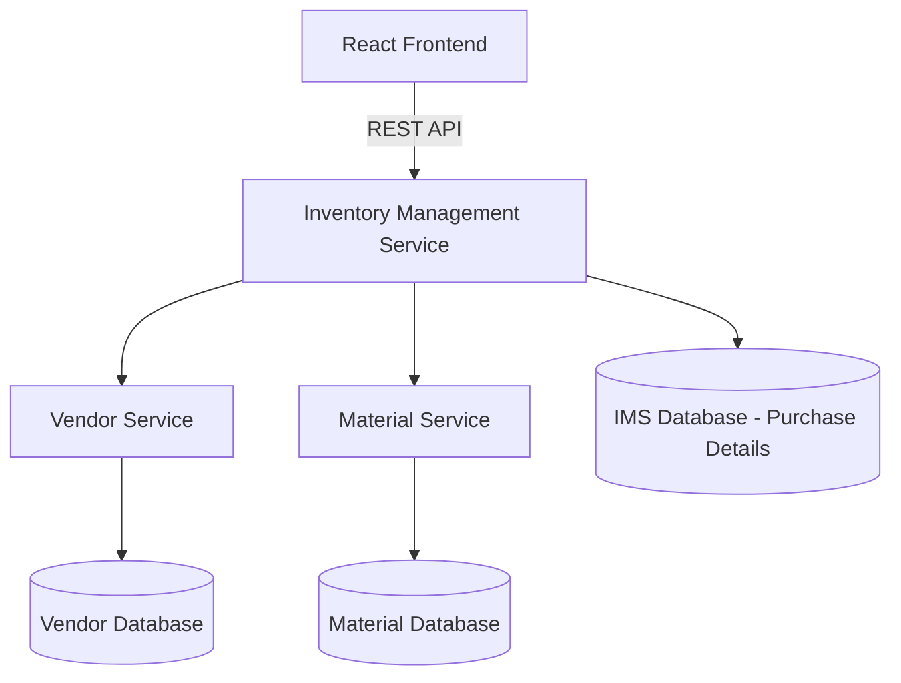

# Inventory Management System (IMS)

A full-stack web-based Inventory Management System developed using **Java, Spring Boot, React.js, MySQL, and Microservices Architecture**.

## Project Overview

The Inventory Management System helps manage vendor details, material information, purchase transactions, and vendor-wise purchase reports.

The application follows a microservices architecture. Vendor Service, Material Service, and Inventory Management Service operate independently and maintain separate databases.

The React frontend communicates with the Inventory Management Service, which consumes data from Vendor Service and Material Service through REST APIs.

## System Architecture

The application consists of four main modules:

### 1. React Frontend
- Developed using React.js and Vite.
- Provides the user interface.
- Handles login, vendor selection, material selection, purchase entry, and report viewing.
- Communicates with the backend using REST APIs.

### 2. Vendor Service
- Developed using Spring Boot.
- Manages vendor information.
- Provides REST APIs to retrieve vendor details.
- Maintains its own MySQL database.

### 3. Material Service
- Developed using Spring Boot.
- Manages material categories, material types, and units.
- Provides REST APIs to retrieve material information.
- Maintains its own MySQL database.

### 4. Inventory Management Service (IMS)
- Developed using Spring Boot.
- Handles purchase entry operations.
- Communicates with Vendor Service and Material Service.
- Stores purchase transaction details.
- Generates vendor-wise purchase reports.
- Maintains its own MySQL database.

## Architecture Diagram



Each microservice maintains its own independent database.

## Technologies Used

| Category | Technologies |
|---|---|
| Programming Language | Java |
| Backend | Spring Boot |
| Frontend | React.js, Vite |
| Database | MySQL |
| ORM | Spring Data JPA, Hibernate |
| API Communication | REST APIs |
| Build Tool | Maven |
| IDE | Eclipse, VS Code |
| Version Control | Git, GitHub |
| CI/CD | Jenkins |
| Code Quality | SonarQube |

## Application Features

- Admin login.
- Vendor details retrieval.
- Material category selection.
- Dynamic material type and unit selection.
- Purchase entry management.
- Purchase transaction storage.
- Vendor-wise purchase reports.
- Date-range-based report filtering.
- Separate databases for each microservice.

## Login Credentials

For demonstration and local testing:

| Field | Value |
|---|---|
| Username | admin |
| Password | admin |

**Note:** These are default demo credentials for testing purposes only. They should not be used in a production environment.

## Project Structure

```text
Inventory-Management-System/
│
├── ims-frontend/
│
├── InventoryManagementSystem/
│
├── MaterialService/
│
├── vendorservice/
│
├── .gitignore
│
└── README.md
```

## Local Development Setup

### Prerequisites

Make sure the following software is installed:

- Java Development Kit (JDK)
- Maven
- Node.js and npm
- MySQL Server
- Git

### Backend Configuration

Configure database credentials and service URLs in the respective `application.properties` files.

Use environment variables for database credentials:

- `DB_USERNAME`
- `DB_PASSWORD`

### Backend Services and Ports

| Service | Port | Database |
|---|---:|---|
| Vendor Service | 8084 | vendordb |
| Material Service | 8085 | materialdb |
| Inventory Management Service | 8086 | imsdb |

### Start Backend Services

Start the backend services in the following order:

1. Vendor Service.
2. Material Service.
3. Inventory Management Service.

Each service can be started through Eclipse or using Maven.

### Start Frontend

Open a terminal and navigate to the frontend directory:

```bash
cd ims-frontend
```

Install the required dependencies:

```bash
npm install
```

Start the React development server:

```bash
npm run dev
```

Local frontend URL:

http://localhost:5173

## Application Workflow

1. The user logs into the React frontend.
2. Vendor details are retrieved through Vendor Service.
3. Material categories are retrieved through Material Service.
4. Based on the selected category, material types and units are retrieved.
5. The user enters purchase details and submits the form.
6. IMS stores the purchase transaction in its database.
7. The user can view vendor-wise purchase reports by selecting a vendor and date range.

## Microservices Communication

The Inventory Management Service consumes REST APIs exposed by Vendor Service and Material Service.

Each microservice is independently developed and maintains its own database.

This separation helps maintain modularity and independent service responsibilities.

## Future Enhancements

- Docker containerization.
- Cloud deployment.
- Centralized logging and monitoring.
- Improved authentication and authorization.

## Author

Developed as a full-stack Inventory Management System project using Java, Spring Boot, React.js, MySQL, and Microservices Architecture.
