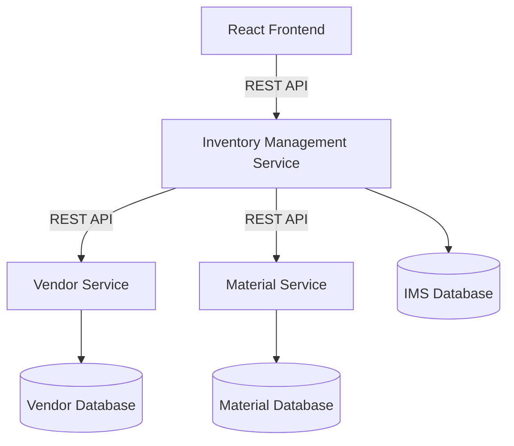

# Inventory Management System (IMS)

A full-stack Inventory Management System developed using Java, Spring Boot, React.js and Microservices Architecture. The application manages vendor details, material information, purchase transactions and purchase reports.

## Project Overview

The Inventory Management System simplifies purchase management through a centralized web application.

It follows a microservices architecture consisting of three backend services:

- **Vendor Service:** Manages vendor information.
- **Material Service:** Manages material categories, types and units.
- **Inventory Management Service:** Handles purchase transactions and report generation.

The React frontend communicates with the Inventory Management Service through REST APIs.

## Key Features

- Admin login interface.
- Vendor details retrieval.
- Material category selection.
- Dynamic material type and unit selection.
- Purchase entry management.
- Purchase transaction storage.
- Vendor-wise purchase reports.
- Date-range-based report filtering.
- Independent databases for each microservice.

## System Architecture

The application consists of a React frontend and three independent Spring Boot microservices.

### Architecture Diagram



Each microservice maintains its own database and communicates through REST APIs.

## Technology Stack

| Category | Technologies |
|---|---|
| Programming Language | Java |
| Backend | Spring Boot |
| Frontend | React.js, Vite |
| Database | TiDB Cloud (MySQL compatible) |
| ORM | Spring Data JPA, Hibernate |
| API Communication | REST APIs |
| Build Tool | Maven |
| Containerization | Docker |
| Container Orchestration | Docker Compose |
| Version Control | Git, GitHub |
| Container Registry | Docker Hub |
| IDE | Eclipse, VS Code |

## Project Structure

```text
Inventory-Management-System/
│
├── ims-frontend/
│   ├── src/
│   ├── public/
│   ├── Dockerfile
│   ├── nginx.conf
│   └── package.json
│
├── InventoryManagementSystem/
│   ├── src/
│   ├── pom.xml
│   └── Dockerfile
│
├── MaterialService/
│   ├── src/
│   ├── pom.xml
│   └── Dockerfile
│
├── vendorservice/
│   ├── src/
│   ├── pom.xml
│   └── Dockerfile
│
├── docker-compose.yml
├── .gitignore
└── README.md
```

## Application Workflow

1. The user accesses the application through the React frontend.
2. Vendor details are retrieved from Vendor Service.
3. Material categories are retrieved from Material Service.
4. Based on the selected category, the corresponding material types and units are loaded.
5. The user enters purchase details and submits the form.
6. Inventory Management Service processes the request and stores the purchase transaction.
7. The user can generate vendor-wise purchase reports using a selected date range.

## Microservices and Database Configuration

| Microservice | Port | Database |
|---|---:|---|
| Vendor Service | 8084 | vendordb |
| Material Service | 8085 | materialdb |
| Inventory Management Service | 8086 | imsdb |

The application uses TiDB Cloud with MySQL-compatible database connectivity.

Database configuration is managed through environment variables. Database credentials should not be committed to the repository.

## API Endpoints

### Inventory Management Service

| Method | Endpoint | Description |
|---|---|---|
| GET | `/vendors` | Retrieves vendor details |
| GET | `/categories` | Retrieves material categories |
| POST | `/getUnitAndTypeList` | Retrieves material types and units based on category |
| POST | `/addPurchaseDetail` | Saves purchase details |

### Vendor Service

| Method | Endpoint | Description |
|---|---|---|
| GET | `/vendor/controller/getVendors` | Retrieves all vendors |

### Material Service

| Method | Endpoint | Description |
|---|---|---|
| GET | `/material/controller/getMaterialCategories` | Retrieves material categories |

## Local Setup and Installation

### Prerequisites

Install the following tools:

- Java 17
- Maven
- Node.js and npm
- Docker Desktop
- Git
- TiDB Cloud account or a compatible MySQL database

### 1. Clone the Repository

```bash
git clone https://github.com/Spoorthiak/Inventory-Management-System.git

cd Inventory-Management-System
```

### 2. Configure Database Credentials

Configure the required database connection details and credentials using environment variables or the local application configuration files.

Do not commit actual database passwords or other secrets to GitHub.

### 3. Run Using Docker Compose

Make sure Docker Desktop is running.

Start all application services:

```bash
docker compose up -d
```

Check the running containers:

```bash
docker compose ps
```

Stop the containers:

```bash
docker compose down
```

**Note:** Configure the database environment variables and ensure the Docker images referenced by `docker-compose.yml` are available locally or can be pulled from Docker Hub.

### 4. Run Without Docker

Start the backend services in the following order:

1. Vendor Service
2. Material Service
3. Inventory Management Service

Configure their respective database connections and service URLs.

Start the React frontend:

```bash
cd ims-frontend

npm install

npm run dev
```

Open the application:

```text
http://localhost:5173
```

## Application URLs

| Component | Local URL |
|---|---|
| React Frontend | http://localhost:5173 |
| Inventory Management Service | http://localhost:8086 |
| Vendor Service | http://localhost:8084 |
| Material Service | http://localhost:8085 |

## Docker Hub Images

The Docker images for the project are available on Docker Hub:

- [IMS Frontend](https://hub.docker.com/r/spoorthiak/ims-frontend)
- [IMS Backend](https://hub.docker.com/r/spoorthiak/ims-main)
- [Vendor Service](https://hub.docker.com/r/spoorthiak/ims-vendor)
- [Material Service](https://hub.docker.com/r/spoorthiak/ims-material)

## Author

Developed as a full-stack Inventory Management System project using Java, Spring Boot, React.js, Docker and Microservices Architecture.
